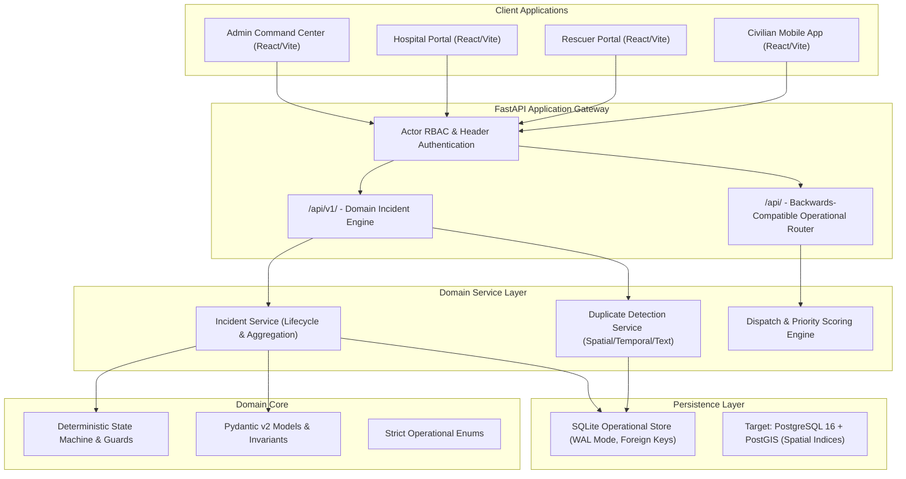
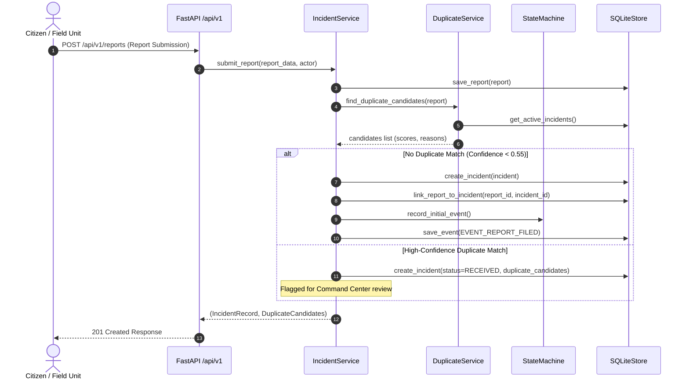

# ATLAS Architecture & Engineering Specification

## 1. Executive Summary & System Purpose
**ATLAS (Adaptive Terrain Intelligence & Life-saving Action System)** is a mission-critical emergency coordination and decision-support platform designed for disaster response operations. It connects command staff, emergency medical facilities, field search-and-rescue teams, and civilians through a unified operational backend.

ATLAS enforces an operational loop of:
$$\text{OBSERVE} \longrightarrow \text{ASSESS} \longrightarrow \text{COORDINATE} \longrightarrow \text{ACT} \longrightarrow \text{REASSESS}$$

---

## 2. High-Level Modular Architecture



---

## 3. Directory Layout and Component Boundaries

```
backend/
├── app/
│   ├── api/
│   │   ├── v1/
│   │   │   ├── dependencies.py    # Actor context injection & RBAC security guards
│   │   │   ├── router.py          # RESTful /api/v1 endpoints
│   │   │   └── schemas.py         # Request and Response DTOs
│   ├── db/
│   │   └── sqlite_store.py        # SQLite persistent storage with WAL and foreign keys
│   ├── domain/
│   │   ├── enums.py               # Operational enums (Status, Priority, Types, Roles)
│   │   ├── models.py              # Core entities (IncidentRecord, IncidentReport, IncidentEvent)
│   │   └── state_machine.py       # Formal state machine, guard conditions, and transition validator
│   ├── services/
│   │   ├── duplicate_service.py   # Multi-factor duplicate detection (Geodesic, temporal, lexical)
│   │   └── incident_service.py    # Business orchestration, multi-report merging, audit trail
│   ├── engine.py                  # Operational heuristic assignment & routing
│   ├── main.py                    # Root FastAPI instance mounting /api and /api/v1
│   └── mock_data.py               # Seed scenarios and initial operational dataset
└── tests/
    ├── test_incident_engine.py    # 14 comprehensive tests for Phase 1 Incident Engine
    ├── test_engine.py             # Heuristic dispatch and routing tests
    └── test_e2e_workflow.py       # End-to-end integration tests
```

---

## 4. Operational Data Flow



---

## 5. Storage Strategy & PostGIS Migration Path

1. **Current Implementation (Phase 1):**
   - SQLite 3 with Write-Ahead Logging (`PRAGMA journal_mode=WAL;`).
   - Foreign key constraint enforcement (`PRAGMA foreign_keys=ON;`).
   - Standard indexes on `status`, `type`, `priority`, `created_at`, `incident_id`.
   - Thread-safe connection context manager handling transactions and rollbacks.

2. **Production Migration Path (Phase 2):**
   - **Database:** PostgreSQL 16 with PostGIS extension.
   - **Spatial Indexing:** Replacing Haversine calculation with native PostGIS `GEOMETRY(Point, 4326)` and `ST_DWithin` spatial indices (`GIST(geom)`).
   - **Concurrency:** Connection pooling via asyncpg / SQLAlchemy 2.0 with row-level locks on incident status updates (`SELECT FOR UPDATE`).
   - **Data Integrity:** Schema migration managed via Alembic.

---

## 6. Security & Actor Tracking (RBAC)

Every mutating request requires caller identity metadata transmitted via HTTP headers:
- `X-Actor-ID`: Unique identifier of the actor or user.
- `X-Actor-Name`: Human-readable name.
- `X-Actor-Role`: Role enum (`admin`, `dispatcher`, `rescuer`, `hospital_staff`, `civilian`, `system`).

The RBAC guard (`require_roles`) enforces:
- `civilian`: Limited to creating reports and viewing their own status.
- `rescuer`: Permitted to update operational response states (`en_route`, `on_scene`).
- `hospital_staff`: Permitted to manage hospital admissions and referrals.
- `dispatcher` & `admin`: Full authority to verify, re-prioritize, resolve, reopen, and reassign incidents.
