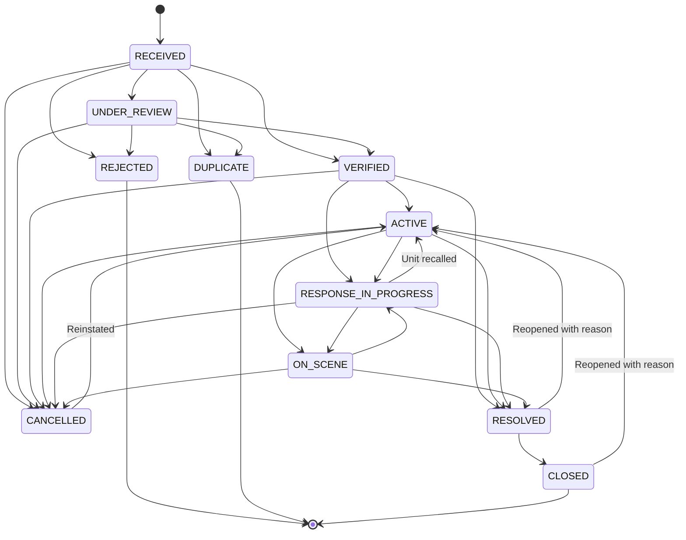

# ATLAS Incident Engine Specification

## 1. Domain Models & Schemas

The incident engine models emergency phenomena with strict type safety, field validation, and spatial constraints.

### Core Entities

1. **`IncidentRecord`**: The authoritative operational incident entity managed by emergency dispatchers.
   - `id`: Unique identifier (e.g., `INC-101` or UUID).
   - `title`: Short title (5-200 characters).
   - `description`: Detailed operational narrative (minimum 10 characters).
   - `type`: Strict emergency classification (`IncidentType`).
   - `category`: Functional grouping (`IncidentCategory`).
   - `status`: Current lifecycle phase (`IncidentStatus`).
   - `verification_status`: Truth validation (`VerificationStatus`).
   - `priority`: Operational urgency score (`PriorityLevel`).
   - `latitude` / `longitude`: Validated GPS coordinates (Lat: $[-90, 90]$, Lon: $[-180, 180]$).
   - `location_name`: Human-readable landmark/address.
   - `affected_people_count`: Non-negative integer.
   - `assigned_team_id` / `assigned_team_name`: Unit metadata.
   - `report_ids`: Set of constituent reports linked to this incident.
   - `resolution_notes`: Documented justification when resolved.
   - `reopen_reason`: Mandatory justification when reopened.

2. **`IncidentReport`**: Raw citizen or field report submission preserved in its original form. Multiple reports can be merged into a single `IncidentRecord`.

3. **`IncidentEvent`**: Append-only audit record capturing every lifecycle change, actor details, timestamp, previous status, next status, and metadata.

---

## 2. Deterministic Lifecycle State Machine

### Status Enums
- `RECEIVED`: Ingested by system, pending review.
- `UNDER_REVIEW`: Triage personnel assessing validity.
- `VERIFIED`: Confirmed genuine emergency.
- `REJECTED`: Spurious report or hoax.
- `DUPLICATE`: Flagged as duplicate of an existing incident.
- `ACTIVE`: Queued for dispatch and team allocation.
- `RESPONSE_IN_PROGRESS`: Rescue units en route to scene.
- `ON_SCENE`: Rescue units physically on site.
- `RESOLVED`: Field operations finished, threat mitigated.
- `CLOSED`: Administrative sign-off completed.
- `CANCELLED`: Operation aborted.

### Formal Lifecycle State Graph

### Transition Guard Rules
1. **Resolution Guard:** Cannot transition to `RESOLVED` without providing `resolution_notes` (minimum 5 characters).
2. **Reopen Guard:** Cannot transition from `RESOLVED`, `CLOSED`, or `CANCELLED` back to `ACTIVE` without a documented `reopen_reason` (minimum 5 characters).
3. **Immutability:** Once an incident is marked `REJECTED` or `DUPLICATE`, it cannot transition to operational states without administrative override.

---

## 3. Duplicate Incident Detection Algorithm

Duplicate detection evaluates four deterministic multi-factor parameters:

$$C = (0.40 \times S_{\text{dist}}) + (0.30 \times S_{\text{type}}) + (0.20 \times S_{\text{time}}) + (0.10 \times S_{\text{text}})$$

Where:
1. **Spatial Proximity Score ($S_{\text{dist}}$):**
   Calculated using the great-circle Haversine formula:
   $$d = 2R \arcsin\left(\sqrt{\sin^2\left(\frac{\Delta\phi}{2}\right) + \cos(\phi_1)\cos(\phi_2)\sin^2\left(\frac{\Delta\lambda}{2}\right)}\right)$$
   $$S_{\text{dist}} = \max\left(0, 1.0 - \frac{d}{d_{\text{threshold}}}\right) \quad (\text{Default } d_{\text{threshold}} = 500\text{ meters})$$

2. **Emergency Type Matching ($S_{\text{type}}$):**
   Strict categorical match:
   $$S_{\text{type}} = \begin{cases} 1.0 & \text{if } \text{Type}_{\text{new}} = \text{Type}_{\text{existing}} \\ 0.0 & \text{if } \text{Type}_{\text{new}} \neq \text{Type}_{\text{existing}} \end{cases}$$
   *(Non-matching types at the same location represent distinct concurrent emergencies).*

3. **Temporal Proximity Score ($S_{\text{time}}$):**
   $$S_{\text{time}} = \max\left(0, 1.0 - \frac{\Delta t}{T_{\text{window}}}\right) \quad (\text{Default } T_{\text{window}} = 2.0\text{ hours})$$

4. **Lexical Keyword Similarity ($S_{\text{text}}$):**
   Jaccard token similarity over normalized, stopword-stripped descriptions:
   $$J(A, B) = \frac{|A \cap B|}{|A \cup B|}$$

### Candidate Threshold
If composite confidence score $C \ge 0.55$, the existing incident is flagged as a duplicate candidate with human-readable rationale (e.g., *"Immediate spatial proximity (42m)"*, *"Identical emergency type (Flooding)"*).
